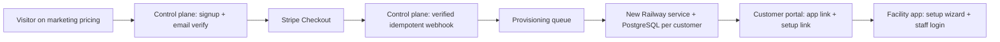

# Cloud Release Plan — Minimal Production SaaS Completion

> Status: account slice implemented locally. CP-01, CP-02 and account audit CP-12 have 15 passing PostgreSQL tests and a built, locally ready Docker image. Hosted deployment and customer provisioning remain open. Stripe checkout, billing and paid activation are explicitly deferred by the user.
> Source assessment date: 2026-11-08. All existing-code claims verified by direct file inspection this session.

## Goal

Current delivery: `control-plane/` contains the independently locked signup,
POST email verification, opaque-cookie login/logout, recovery with session
revocation, canonical origin/CSRF enforcement and encrypted leased email outbox.
The Gmail sender was authorized through a dedicated Google Cloud project on
2026-11-08. Its credentials are stored outside the repository, encrypted for the
operator's Windows user. Google app publishing status remains Testing, so its
refresh-token lifetime is unsuitable for unattended production acceptance.
Live delivery and hosted secret injection require separate evidence.
The remaining sections describe the target architecture and future work,
including deferred Stripe requirements; they are not claims of completion.

Complete the smallest production SaaS surface that turns the current single-deployment codebase into a sellable multi-customer cloud product: public signup → verified email → Stripe checkout → queued provisioning of one isolated Railway application service plus one PostgreSQL database per customer → authenticated customer portal linking to the real facility app and authorized bootstrap setup.

## Decisions

- Desktop is the primary distribution. Cloud work must not regress desktop packaging, loopback backend, or per-user SQLite behavior.
- One Railway application service and one separate PostgreSQL database per customer (selected 2026-11-07).
- Pricing: Community self-hosted $0, Pro Cloud $199/facility/month, Enterprise $399/facility/month. Bed counts describe a facility and never select a plan; estimates never initiate a charge.
- The implementation uses a central service and database for customer signup, login, recovery, billing and portal access. Clinical staff authentication stays in each facility app database. The control plane stores no patient records.
- Commercial and legal documents remain drafts requiring review; this plan claims no executed agreement.

## Success Criteria

- A stranger can sign up, verify email, pay via Stripe, and reach a working isolated facility app without founder intervention.
- Every paid entitlement is enforced by the existing `requireTier` / `<FeatureGate>` contracts, fed by a real issued license key.
- Billing failures degrade to administrative dunning only; the zero-clinical-lockout invariant holds end to end.
- Provisioning is queued and recoverable: a crashed or retried job never creates duplicate customer infrastructure or double charges.
- No synthetic provider status is presented as real anywhere in signup, portal, or setup.

## Approach

Add one new central account control-plane service with its own database. Reuse the facility app untouched for clinical work: the control plane provisions a standard facility deployment (per `docs/RAILWAY_DEPLOYMENT.md`), injects unique per-facility secrets, issues a signed license key the existing server already verifies, and hands the customer a link to the real app plus an authorized path through the existing setup contract (`GET /api/setup/status`, `POST /api/setup/initialize`).

## Flow

## Existing Code (verified) vs Missing Work

| Area | Existing (file) | Missing |
|---|---|---|
| License tiers client | `src/security/license.ts` parses `SH_PRO_` / `SH_ENT_`, tiers community/pro/enterprise/demo | Server-side key issuance/minting; no endpoint creates keys |
| License gate server | `server/src/middleware/requireTier.ts` HMAC-SHA256 verify via `LICENSE_SIGNING_SECRET`, 402 `LICENSE_TIER_REQUIRED` | Wiring issued keys to paying accounts |
| License gate UI | `src/components/FeatureGate.tsx` tier card + key activation | Link from portal into key activation |
| Facility setup contract | `server/src/routes/setup.ts`: `GET /status`, `POST /initialize` guarded by `X-Setup-Secret`/`SETUP_BOOTSTRAP_SECRET`, one-shot lock, zod schema, audit `SETUP_INITIALIZE` | Control-plane-issued per-facility bootstrap secret + setup deep link |
| Setup wizard UI | `src/features/setup/SetupWizardPage.tsx` 6-step wizard posting the setup contract | Prefill/authorize path from portal handoff |
| Pricing estimate | `server/src/routes/billing.ts` `GET /api/billing/estimate` with `COMMUNITY`/`PRO_TIER`/`ENTERPRISE_TIER` ($0/$199/$399) | Real checkout that charges the selected plan |
| Stripe webhook verify | `server/src/routes/billing.ts` `verifyStripeWebhookSignature`: raw-body HMAC, 300 s tolerance, fail-closed 503 without secret | Idempotent event ledger; subscription/provision side effects (current handler is pure and in-memory) |
| Dunning invariant | `server/src/billing/stripeEngine.ts`: `clinicalLockoutAllowed: false`, 14-day grace, `notificationDispatched: false` | Real notification transport; persisted dunning state |
| Webhook idempotency | `server/src/middleware/idempotency.ts` explicitly EXCLUDES `/api/billing`, `/api/auth`, `/api/setup`, webhooks | Stripe event-id dedup store in control plane |
| Clinical staff auth | `server/src/routes/auth.ts`: facility JWT access/refresh, TOTP MFA, sessions | Nothing here — must stay separate; account auth is new in control plane |
| Facility isolation | One-facility-per-database (`SHORELINE_FACILITY_ID`, migration 032 RLS) | Per-customer deployment automation producing that boundary |
| Railway pattern | `docs/RAILWAY_DEPLOYMENT.md`: one service + managed Postgres, required vars, `/ready` gate | API-driven per-customer provisioning worker |
| Desktop primary | `docs/DESKTOP_SAAS_RELEASE.md` acceptance map D01–D04, S01–S03, X01–X02 | S02 (public signup → working account) is the gap this plan closes |
| Marketing pricing | `marketing/src/pages/pricing.astro` 3-tier grid | Signup/checkout/portal links (page currently links only to demo) |
| Simulated enterprise data | `server/src/routes/enterprise.ts` parked B13 static facility list | Must never feed the portal; real deployment status only |

## Contracts to Reuse (do not redesign)

- License key format `SH_PRO_<payload>.<sig>` / `SH_ENT_<payload>.<sig>`; server verifies `HMAC-SHA256(payloadPart)` with `LICENSE_SIGNING_SECRET` and honors `exp`/`facility` claims (`server/src/middleware/requireTier.ts`). The control plane must mint keys in exactly this shape.
- Setup initialize schema: `facilityName`, `facilityType` (Assisted Living, Skilled Nursing, Memory Care, Continuing Care), non-empty `wings` and `diningRooms` arrays (customer-supplied; no preset values invented here), `adminName`, `adminEmail`, 12+ character mixed-case/numeric/special `adminPassword`, `primaryContactEmail`, `baaSigneeName` (setup representative only, not a contract signature), `initMode` clean/sample with server-side seed gate (`server/src/routes/setup.ts`).
- Setup authorization: `X-Setup-Secret` header compared timing-safe against per-deployment `SETUP_BOOTSTRAP_SECRET` (min 16 chars). The control plane generates and delivers this secret; the facility app keeps verifying it.
- Billing estimate plans `COMMUNITY` / `PRO_TIER` / `ENTERPRISE_TIER` and totals $0/$199/$399 (`server/src/billing/stripeEngine.ts`, covered in `server/src/system.test.ts` §28). Checkout price IDs must map 1:1 to these plans.
- Stripe signature scheme: signed payload `<timestamp>.<raw bytes>`, HMAC-SHA256, ±300 s tolerance, fail closed (`server/src/routes/billing.ts`, `docs/WEBHOOKS.md`). The control-plane webhook reuses this verifier unchanged.

## Requirements

| ID | Requirement | Owner |
|---|---|---|
| CP-01 | Public signup creates a control-plane account with verified email before any paid entitlement | Server/API |
| CP-02 | Account login, session management, and password recovery, isolated from clinical staff auth | Server/API + Security review |
| CP-03 | Stripe Checkout for Pro ($199) and Enterprise ($399) facility plans; Community ($0) needs no checkout | Server/API |
| CP-04 | Stripe webhook signature verification reused from existing verifier, plus persistent per-event-id idempotency | Server/API |
| CP-05 | Webhook side effects (subscription state, license issuance, provisioning enqueue) apply exactly once per event | Server/API + Database |
| CP-06 | Queued, recoverable Railway provisioning: one app service + one PostgreSQL database per customer, resumable after crash | Server/API |
| CP-07 | Unique secrets per facility (signing, bootstrap, session, encryption); never shared across customers | Security review + Server/API |
| CP-08 | Authenticated customer portal: plan status, invoices via Stripe portal, facility app link, setup link | Web app + Server/API |
| CP-09 | Portal links resolve to the real provisioned facility app; setup link carries an authorized bootstrap handoff accepted by the existing setup contract | Server/API + Web app |
| CP-10 | License issuance mints `SH_PRO_`/`SH_ENT_` keys verifiable by the existing server gate; expiry and tier match the paid subscription | Server/API |
| CP-11 | Marketing pricing links to real signup/checkout; no dead or demo-masked purchase path | Marketing site |
| CP-12 | Control-plane audit log for account, billing, and provisioning actions; no patient records stored | Database + Security review |

Out of scope: desktop packaging changes, clinical features, EHR/distributor/USDA provider work, TV/iOS, plugin marketplace, and any change to the facility clinical schema.

## Database and Schema Constraints

Control-plane database (new, central, one instance):

- Tables (proposed): `accounts`, `account_emails` (verification), `account_sessions`, `password_resets`, `subscriptions`, `facilities` (deployment metadata only), `provisioning_jobs`, `provisioning_events`, `stripe_events` (event-id ledger), `licenses_issued`, `control_audit_log`.
- `stripe_events.stripe_event_id` UNIQUE; insert-then-process inside one transaction gives exactly-once side effects (CP-05).
- `accounts.email` UNIQUE (case-normalized); `subscriptions.stripe_customer_id` UNIQUE; `facilities.public_hostname` UNIQUE.
- Token columns store SHA-256 hashes only (same pattern as facility `refresh_tokens.token_hash`); plaintext verification/reset tokens exist only in the emailed link.
- No patient-record tables or columns: no residents, census, diet orders, allergens, textures, tray data, temperatures, or clinical audit content. `facilities` holds only: account reference, plan tier, provider service/database identifiers, public URL, setup status flag, timestamps.
- Provisioning jobs carry a state machine (`queued` → `creating` → `verifying` → `ready`, plus `failed`/`dead`) with attempt count, next-retry timestamp, and last provider-reported status; recovery replays from stored state, never by re-creating blindly.

Facility database (existing, per customer, unchanged schema):

- One-facility-per-database boundary preserved; `facility_config` row `id='default'` initialized exactly once via the existing setup contract.
- Account JWTs and facility staff JWTs use different issuers/audiences/secrets and must not cross-validate (CP-02).

## Provider Configuration Gates

Each gate fails closed with an explicit status; signup/checkout/provisioning surfaces report unavailability instead of simulating success.

| Provider | Required names (values never committed) | Gate behavior |
|---|---|---|
| Stripe payments | `STRIPE_SECRET_KEY`, `STRIPE_WEBHOOK_SECRET`, `STRIPE_PRICE_PRO`, `STRIPE_PRICE_ENTERPRISE` | Checkout and webhook refuse traffic until set; price IDs must match $199/$399 plans |
| Railway provisioning | `RAILWAY_API_TOKEN`, control-plane `RAILWAY_PROJECT_ID` (or equivalent project reference) | Provisioning jobs stay queued with `provider_unconfigured`; portal shows pending, never a fake URL |
| Transactional email | `GMAIL_CLIENT_ID`, `GMAIL_CLIENT_SECRET`, `GMAIL_REFRESH_TOKEN`, `GMAIL_SENDER` | Gmail OAuth2 delivery selected by the user. Verification and recovery require configured authorization; no sender or token values are committed. |
| Facility deployment | per-customer `DATABASE_URL`, `JWT_SECRET` (≥32 chars), `SETUP_BOOTSTRAP_SECRET` (≥16 chars), `LICENSE_SIGNING_SECRET` (≥32 chars), `FRONTEND_URL`, `NODE_ENV=production` (per `docs/RAILWAY_DEPLOYMENT.md` + `.env.example` names) | Provisioning verifies `/ready` and `/api/setup/status` before marking `ready` |

Local configuration inspected by names only: `.env`, `.env.local`, `.env.example`, `railway.json`, `render.yaml`, `vercel.json`, `docker-compose.yml`, `docker-compose.production.yml`, `Dockerfile`, `Dockerfile.demo`, `Dockerfile.marketing`. No secret values were read or are recorded here.

## Implementation Files

New control-plane service (proposed `control-plane/` directory; Express + TypeScript mirroring `server/` conventions):

- `control-plane/package.json`, `control-plane/tsconfig.json` — service manifest, build config
- `control-plane/src/index.ts` — app boot, mounts, `/health`, `/ready`
- `control-plane/src/db/pool.ts`, `control-plane/src/db/migrate.ts` — central DB pool + migrations
- `control-plane/src/db/migrations/001_accounts.sql` — accounts, emails, sessions, resets, audit
- `control-plane/src/db/migrations/002_billing.sql` — subscriptions, stripe event ledger, licenses issued
- `control-plane/src/db/migrations/003_provisioning.sql` — facilities, provisioning jobs/events
- `control-plane/src/routes/signup.ts` — CP-01 (signup, email verify, resend)
- `control-plane/src/routes/accountAuth.ts` — CP-02 (login, refresh, logout, password reset)
- `control-plane/src/routes/checkout.ts` — CP-03 (Checkout Session create, plan mapping)
- `control-plane/src/routes/stripeWebhook.ts` — CP-04/CP-05 (verifier reuse + event ledger + dispatch)
- `control-plane/src/routes/portal.ts` — CP-08/CP-09 (status, app/setup links, Stripe portal session)
- `control-plane/src/billing/licenseIssuer.ts` — CP-10 (HMAC key minting in existing format)
- `control-plane/src/provisioning/queue.ts` — CP-06 (durable job queue, backoff, crash recovery)
- `control-plane/src/provisioning/railway.ts` — CP-06/CP-07 (service + database create, secrets inject, status poll)
- `control-plane/src/provisioning/secrets.ts` — CP-07 (per-facility secret generation)
- `control-plane/src/email/sender.ts` — verification and recovery mail behind the email gate
- `control-plane/src/portal/` — portal UI (status, invoices link, app/setup links) or equivalent web app routes
- `control-plane/src/*.test.ts` — acceptance coverage per CP/AT mapping below

Facility-side and marketing edits (minimal):

- `marketing/src/pages/pricing.astro` — CP-11: point plan CTAs at control-plane signup/checkout
- `server/src/routes/billing.ts` — read-only reference for verifier reuse; no behavior change expected
- `src/features/setup/SetupWizardPage.tsx` — CP-09 (optional): accept portal handoff token to pre-authorize the setup secret field; existing manual path unchanged
- `server/src/routes/setup.ts` — only if the handoff token needs a verification endpoint; prefer zero change by delivering the bootstrap secret through the portal

## Acceptance Tests

| ID | Covers | Check | Expected evidence |
|---|---|---|---|
| AT-01 | CP-01 | Sign up, verify email via real link, attempt login before verification | Unverified login refused; verified login succeeds |
| AT-02 | CP-02 | Login, refresh, logout, password reset; replay a facility staff token against control plane and vice versa | Reset works; cross-token replay rejected both directions |
| AT-03 | CP-03 | Start Pro and Enterprise checkouts in Stripe test mode | Sessions charge $199 / $399 per facility; Community path needs no session |
| AT-04 | CP-04 | POST forged, replayed-outside-tolerance, and valid Stripe events | 400/503 fail-closed; valid event accepted once |
| AT-05 | CP-05 | Deliver the same `checkout.session.completed` event twice and kill the worker mid-job | One subscription, one license, one provisioning job; resume completes without duplicates |
| AT-06 | CP-06 | Provision two customers, force a mid-create failure, restart worker | Each customer ends with exactly one service + one database; failed job retries to `ready` |
| AT-07 | CP-07 | Dump provisioned environments (names + hashes only) and compare across facilities | All secret values differ per facility; rotation procedure documented |
| AT-08 | CP-08/CP-09 | Log into portal as payer, open app link and setup link | App link serves the customer deployment; setup completes through the existing wizard and locks on repeat |
| AT-09 | CP-10 | Activate an issued key against a facility app (UI + API) | `SH_PRO_` unlocks pro-only, not enterprise; `SH_ENT_` unlocks both; expired key falls back to community |
| AT-10 | CP-11 | Click every pricing CTA | Each reaches live signup/checkout; no dead link, no demo-masked purchase |
| AT-11 | CP-12, zero lockout | Simulate `invoice.payment_failed` on a live facility subscription | Portal shows past-due/grace; kitchen, tray, and safety endpoints keep serving (existing invariant re-verified) |
| AT-12 | Gates | Unset each provider variable group in staging | Affected surface reports unavailable; nothing fabricates success |

Run order: AT-04/AT-05 (webhook safety) → AT-03 (checkout) → AT-01/AT-02 (identity) → AT-06/AT-07 (provisioning) → AT-08/AT-09 (portal + license) → AT-10/AT-11/AT-12 (surface + gates). Existing gates stay green throughout: `npm run build:demo`, `npm run build:marketing`, `npm test`, `npm run lint` per repo policy.

## Open Questions

- Gmail sender selected by the user on 2026-11-08. Runtime OAuth authorization remains required before live email acceptance.
- Control-plane hosting location (same Railway project as a separate service, or separate project; either satisfies per-customer isolation since the control plane holds no patient records).
- License `exp` and renewal semantics for monthly subscriptions (recommend: `exp` = current period end, reissued on each verified renewal event).

## Sources

- `src/security/license.ts`, `server/src/middleware/requireTier.ts`, `src/components/FeatureGate.tsx`
- `server/src/routes/setup.ts`, `src/features/setup/SetupWizardPage.tsx`
- `server/src/routes/billing.ts`, `server/src/billing/stripeEngine.ts`, `server/src/middleware/idempotency.ts`
- `server/src/routes/auth.ts`, `server/src/routes/webhooks.ts`, `server/src/routes/enterprise.ts`, `server/src/index.ts`
- `server/src/db/migrate.ts` (migrations 027–032 naming), `server/src/system.test.ts` (§28 billing)
- `docs/RAILWAY_DEPLOYMENT.md`, `docs/WEBHOOKS.md`, `docs/DESKTOP_SAAS_RELEASE.md`, `LICENSING.md`, `.env.example` (names only)
- `marketing/src/pages/pricing.astro`, `package.json` (scripts), `TODO.md` (milestone history)
