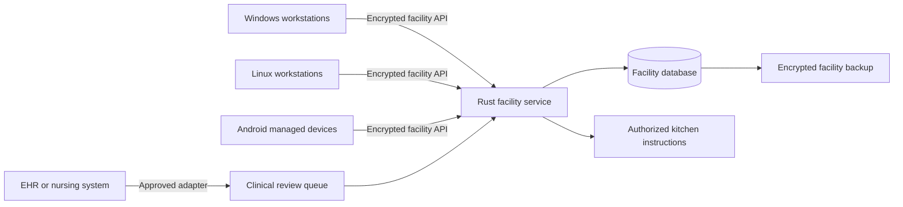

# ShorelineOps native rebuild

Proposed execution plan for assisted living and hospital dietary operations. The release starts with an empty facility and guides an administrator through setup. Installers ship application code, schema migrations, and required reference definitions. Resident, menu, recipe, and order records come from authorized staff or approved imports. Automated verification creates temporary test records outside the installed application.

## Product requirements

| ID | Requirement | Acceptance |
| --- | --- | --- |
| N01 | Native Windows, Linux, and Android applications | Each installs and launches from its platform package without a browser, WebView, or Node.js runtime. |
| N02 | Facility-owned installation | Start on one supported computer with a local facility service, then enroll additional workstations and Android devices against the same service over the facility LAN. The installed system operates without a ShorelineOps cloud connection. |
| N03 | Scoped access to one resident record | Individual identities, device enrollment, facility and unit scope, and separate permissions for viewing, editing, reviewing, approving, and exporting. The server enforces each request. |
| N04 | Integrated dietary and nutrition tools | Compute energy, sugars, carbohydrates, protein, fat, sodium, and other configured nutrients per ingredient, recipe yield, portion, and meal. Show source, units, and completeness. Missing values remain unknown. |
| N05 | Safe meal production and service | Active dietary orders govern meals and trays. Preserve existing non-overridable NPO and allergen blocks, texture and liquid checks, and restrictions on incomplete or stale clinical data. |
| N06 | Dietary review and clinical handoff | Nurses can submit a resident-linked dietary concern to the authorized care team. Dietitians review and record a disposition. Only an authorized order change can update kitchen-facing instructions. |
| N07 | Facility administration | Menu planning, production, purchasing, inventory, costs, and reports are available to assigned roles. Reporting defaults to aggregated views where appropriate. |
| N08 | Private, recoverable operation | Encrypted connections and storage, audited access, managed updates, device revocation, facility backups, and demonstrated restore. |
| N09 | Connect approved clinical and hardware systems | Versioned adapters for approved EHRs and documented device interfaces. Each integration has an explicit mapping, ownership, and verification gate. MCP work is deferred. |
| N10 | Paper workflows for daily service and downtime | Every operational form, work sheet, and report has a printable format. Generate filled forms and reports from approved menus, diet orders, and other current records. Provide blank fields or forms for observations and counts collected by staff. Completed forms can be entered manually or scanned in for review. Both pilot settings validate the full paper workflow. |

## Application and data flow

In single-computer mode the Windows or Linux client uses the facility service on loopback. Network mode exposes the same authenticated API on an IT-approved interface. Android acts as an enrolled client. A client can keep approved, expiring operational views during an outage. The first release requires current server state for clinical changes and tray clearance. Reconnect refreshes permissions and revisions before the client can resume those actions. Facility downtime procedures cover unavailable service.

Use Rust for application logic, native clients, service, migrations, and integrations. Prove a shared native UI renderer on all three platforms before committing to it. Slint is a candidate if its declarative UI files and licensing are acceptable. A Rust-authored UI toolkit is the alternative if UI definitions must also be Rust source. The existing Win32 training executable is prototype evidence for Windows only. Validate keyboard and screen reader use, Android touch ergonomics, printing, and scanning in the renderer spike.

Start with SQLite on the facility host behind a single service owner and transactional writes. Keep the database on local storage. Benchmark concurrent production and reporting workloads before deciding whether a larger-site database option is needed. Use one authoritative schema with versioned forward migrations, pre-upgrade backup, and documented recovery.

## Role and access model

| Role | Typical access | Typical contribution |
| --- | --- | --- |
| Cook or dietary aide | Assigned meal, station, resident identifier, and approved service instructions needed for the task | Production counts, prep completion, and authorized service events |
| Kitchen administrator | Menus, recipes, inventory, ordering, production, costs, and approved service views | Menus, approved substitutions through the clinical workflow, purchase orders, and operational reports |
| Dietitian | Assigned resident nutrition history, diet orders, and dietary concerns | Nutrition review, dispositions, and order changes within granted clinical authority |
| Nurse or prescriber | Assigned residents and clinically relevant dietary information | Dietary concerns and order changes within granted clinical authority |
| HR | Staff administration and permitted workforce reports | Staff records in the workforce area |
| Board member | Approved aggregate reporting | Access to published reports |
| Facility IT or security | System configuration, enrollments, update status, and scoped audit metadata | Device approval, certificate rotation, backup and restore, and security operations |

The workstation profile controls which workspace opens. The signed-in person's role, unit assignment, and granted actions control authorization. Kitchen sees the approved instruction and effective time. Clinical reviewers see the concern and its disposition. Cross-unit access, sensitive exports, emergency access if the facility requires it, and role changes require explicit policies and audit evidence.

## Schema and ownership

| Records | Owner and write boundary |
| --- | --- |
| Facility, units, device enrollment, identities and grants | Facility administration and IT through separate privileged actions |
| Resident identity and external identifiers | Facility-designated census authority. External imports preserve source identifiers and review ambiguous matches. |
| Diet order revisions, allergies, texture and liquid instructions | Authorized clinical actors. Store provenance, author, approval, effective time, and superseded revision. |
| Dietary concern, assignment and disposition | Authorized care team. Keep clinical notes in the clinical scope. |
| Nutrient source, ingredient, recipe version and portion | Approved nutrition sources and facility recipe authors. Preserve units, yield, source version, and verification status. |
| Menu cycle, production, tray and service event | Kitchen operations. Link decisions to the active order and recipe revisions used at the time. |
| Vendor, stock, purchase order and cost records | Purchasing and kitchen management. Report with operational or aggregate projections. |
| Audit events | Service-written. Record actor, device, scope, action, time and outcome with restricted audit access. |

For N06 and N09, begin with a manual concern inbox and a review workflow. Add a read-only EHR adapter after vendor access and a facility data-sharing agreement are established. Evaluate HL7 FHIR NutritionOrder for structured dietary orders where the vendor supports it. Store source references, validate mappings, deduplicate retries, quarantine conflicting updates, and preserve clinician review. Require separate acceptance for write-back.

## Installation, network and HIPAA readiness

1. Offer signed Windows and Android packages and signed Linux packages for a defined distribution baseline. The setup wizard creates the facility, initial admin, storage location, backup destination, and optional LAN configuration.
2. Run read-only preflight checks for host reachability, DNS, TLS trust, listening port, clock, and proxy configuration. Provide a deployment report with required endpoints and firewall rules. Facility IT applies or approves changes through its existing tools. The installer performs only explicitly authorized host configuration. Managed routers, VLANs, bridges, and security appliances stay under facility IT control.
3. Enroll devices with a short-lived, one-time approval. Verify the facility endpoint before credential exchange. Use TLS with facility-approved trust, short-lived user sessions, and revocable device credentials. Store keys using approved OS facilities and keep protected data out of diagnostics, crash reports, and notifications by default.
4. Use standard OS printing and vendor-supported scanner interfaces first. Scope any custom driver to a device with a demonstrated gap, signed driver distribution, and an IT-reviewed deployment.
5. Before live protected data, document the deployment's risk analysis, facility access and retention policies, audit review, workforce procedures, backup and incident response, and applicable vendor agreements. Verify authorization denial, revocation, secure transport, key rotation, recovery, and endpoint management. The facility's privacy and security owners review the controls and evidence before approving a pilot.

## Execution and release gates

| Phase | Work | Exit evidence |
| --- | --- | --- |
| 0 · Baseline | Inventory current clinical rules, routes, permissions, data formats, and operational workflows. Identify how each transfers or is retired. Create the feature traceability matrix. | Named migration decisions and test fixtures per critical workflow. |
| 1 · Native foundation | Build three platform packages, empty facility onboarding, single-host service, persistence, identity, device enrollment and scoped API. | Clean install and restart on all three targets. Enroll two different roles on separate machines and verify cross-role and cross-unit denials. Android hardware passes a real-device check. |
| 2 · Dietary vertical slice | Add resident census, order revisions, recipe nutrition, menu assignment, tray checking, and paper tray orders and prep sheets. | Compare nutrition math and clinical behavior with approved references and existing rules. Prove stale, revoked, NPO, allergen, and unknown-input cases fail closed. Exercise printer and scanner with facility-representative hardware. |
| 3 · Facility operations | Add dietary concern review, production, purchasing, stock, and role-specific reports. | Demonstrate a nurse-to-dietitian concern and a resulting approved instruction reaching the kitchen without exposing clinical notes. Validate reporting permissions and reconciliation. |
| 4 · Migration and pilot | Rehearse import, stage upgrades and rollback, validate security controls, and pilot in assisted living and hospital dietary settings. | Reconcile imported records, prove restore and rollback, and obtain site acceptance for network, clinical safety, privacy, paper forms and reports, and a practiced downtime workflow before live cutover. |
| 5 · Integrations | Deliver approved EHR connectors and additional hardware profiles. | Verify against each partner sandbox and supported device. Obtain approval for any live read or write access. |

## Confirmed pilot decisions

- Assisted living and hospital dietary teams both shape and validate the first pilot. Confirm census, order authority, escalation timing, and EHR dependencies with each site.
- The first complete workflow is resident diet order → menu assignment → tray check.
- During outages, staff can read approved prep views and follow their facility's downtime procedure. Paper tray orders, sheets, and reports are required for daily use as well as downtime.

### Paper workflows

Inventory the actual forms at both pilot sites. Confirm required fields, print frequency, and which roles can print each form. Generate tray orders and prep or production sheets from the same approved revisions used on screen. Include the service date, meal, generation time, and applicable revision. Give each generated form an opaque identifier so a scan can be matched without embedding resident information in a barcode. Verify preview, reprints, printer failure, and order changes after printing. Reports follow the same role and scope rules as on-screen reports.

Support manual entry and scan intake for completed forms. Link the scan to the form and revision, preserve the source image under facility retention rules, and let authorized staff confirm entries before they update records. Automatic extraction, where available, proposes values for review. Unmatched pages, illegible fields, duplicate submissions, and superseded forms go to review. Clinical order changes follow the same authorization and approval workflow as direct entry. Test printing, marking, scanning or entering, reviewing, and reconciling at both pilot sites.

Prepare approved downtime packets before service. Printed records are snapshots. Each site's procedure defines how staff verify orders during downtime, replace superseded copies, and reconcile paper records when the system returns. Audit printing and reprints that contain resident information. The facility sets rules for printer placement, collection, retention, and disposal.

## Open decisions before implementation

| Decision | Proposed starting point | What changes with a different choice |
| --- | --- | --- |
| First facility host | One IT-managed Windows or Linux host, with a documented recovery procedure | A required uptime or recovery target may move failover and database selection into the foundation phase. Confirm who owns the host and restores it. |
| Android device use | Managed Android devices for selected kitchen workflows | Clinical editing, personal devices, or dedicated scanner hardware change enrollment, data retention, and testing requirements. |
| Existing data and integrations | New facilities start empty. Inventory legacy import separately. | A facility that needs day-one import or an EHR feed requires early sample exports, source-of-truth decisions, matching, and reconciliation. |

## Findings from the current checkout

- The current packaged desktop setup uses a loopback backend and browser UI. Reuse its startup readiness and provisioning lessons. Validate the Rust installer and service lifecycle independently. See `desktop/README.md`.
- Kitchen tray checking and tray-run confirmation share `verifyTray`. The latter runs inside a transaction. Preserve that relationship so a resident-order change between display and confirmation cannot authorize a stale tray. Port behavior and failure cases from `server/src/engine/traySafety.ts`, `server/src/routes/trayruns.ts`, and `server/src/tray-safety.test.ts`.
- The browser tablet has an IndexedDB offline mutation queue. Review each queued operation before designing the native offline store. Production observations and clinical decisions need distinct policies.
- Nutrition calculation already includes energy, sugar, and protein. Inventory the calculation rules and bundled data independently, then decide which data qualifies as licensed, attributable reference material for the blank installation. See `server/src/engine/nutrition.ts`.
- Test the toolkit with one representative tray worklist on Windows, Linux, and an Android device. Include Narrator, Orca, and TalkBack, large text, keyboard and scanner input, and Android activity recreation. Slint's Android documentation describes a Rust entry point and declarative UI markup. Keep Rust-authored UI options in the spike until the source-language constraint and accessibility results are settled.

## Phase 0 migration inventory

| Existing behavior | Rust migration and acceptance |
| --- | --- |
| Signed tray checks in `server/src/engine/traySafety.ts`, with service confirmation in `server/src/routes/trayruns.ts` | Port ticket validation, resident and recipe verification, nutrient and texture policy, and transaction-time revalidation together. Use the existing synthetic tray suite as the first comparison and exercise order changes between scan and confirmation. |
| Production paperwork, tray card, kitchen sheet, and reporting entry points | Inventory Paperwork, Worksheet, Tray Tickets, Prep List, Shift Checks, Hydration, Temp Log, and scoped reports with both pilot settings. Port approved layouts to the Rust renderer with revision and scan-intake support. Existing paperwork transfers are reviewed snapshots. |
| SQLite and PostgreSQL data paths in `server/src/db/pool.ts`, plus browser-managed state | Inventory approved exports and field mappings before migration. Keep the existing installation available through cutover. Never attach the legacy database as the Rust service's active store. Verify identifiers, order history, counts, and rejected rows during rehearsal. |
| Existing thermal printing code and generated tray-card route | Use OS print handoff first. Verify paper size, readability, barcode scanning, and paper reconciliation on the pilot printers before selecting direct printer integrations. |

The Rust workspace contains an empty eframe worklist for platform evaluation. Facility onboarding, clinical operation, and paper intake follow the Phase 0 exit gate.

## Primary references

- [HHS HIPAA Security Rule risk analysis and risk management](https://www.hhs.gov/hipaa/for-professionals/faq/what-is-the-difference-between-risk-analysis-and-risk-management-in-the-security-rule/index.html)
- [HHS guidance on connecting systems that exchange health information](https://www.hhs.gov/hipaa/for-professionals/faq/does-the-security-rule-allow-you-to-network-computers/index.html)
- [HL7 FHIR R4 NutritionOrder](https://hl7.org/fhir/R4/nutritionorder.html)
- [USDA FoodData Central API guide](https://fdc.nal.usda.gov/api-guide)
- [Slint Rust Android backend](https://docs.slint.dev/latest/docs/rust/slint/android/)
